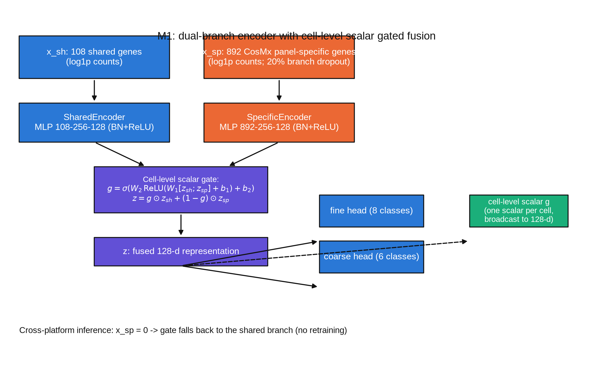
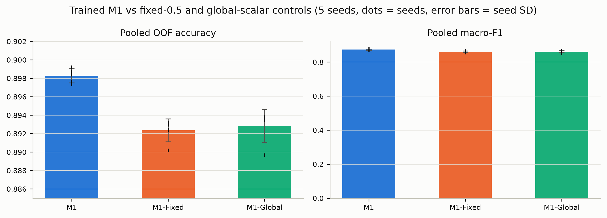
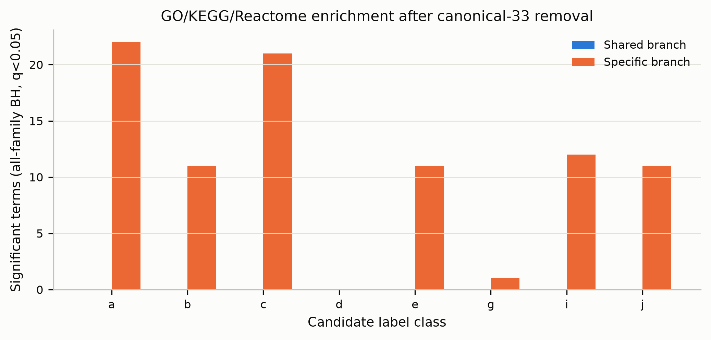

# Cell-Level Gated Fusion of Shared and CosMx Panel-Specific Gene Representations for Cell-Type Annotation across Heterogeneous Imaging-Based Spatial Transcriptomic Panels

Author: hanshitao (韩诗涛)

## Overview

M1 is a dual-branch annotator for cell-type annotation across heterogeneous
imaging-based spatial transcriptomic panels. The **shared branch** encodes
the 108 genes common to the CosMx, MERSCOPE, and Xenium panels, providing
cell-identity information that transfers across platforms. The **CosMx
panel-specific branch** encodes the remaining 892 CosMx genes, supplying
complementary cell-type information available only on that panel. A
**cell-level gate** computes, from each cell's own representations, a scalar
weight that adaptively adjusts how much shared versus panel-specific
information that cell uses. Biological analyses link panel-specific
information to cell-type identity and related functional pathways at the
attribution level; these are associations, not causal claims. The shared
branch shows no statistically supported immune or myeloid enrichment after
multiple-testing correction, and no cross-platform per-cell accuracy is
claimed because no per-cell ground truth exists on the target platforms.

## Performance

On the CosMx 2023 multi-tissue tTMA1 benchmark (37 patients, 169,283 cells,
patient-level three-fold CV, five seeds):

- M1 accuracy: 0.8993 ± 0.0052 (equal-fold mean; pooled 0.8992)
- M1 macro-F1: 0.8168 ± 0.0148 (fold mean; pooled 0.8703)
- Patient-level paired accuracy difference: M1 vs M1-Fixed **+0.5204 pp**
  (p = 1.1e-5); M1 vs M1-Global **+0.4262 pp** (p = 4.7e-5)
- The full-panel linear reference (LR-A) exceeds M1 in accuracy by about
  0.25 pp; M1 does not rank first among all baselines.

## Visual Results



*Dual-branch encoding of shared and CosMx panel-specific genes with a cell-level scalar gate.*



*M1 versus the two retrained controls that differ only in the gating mechanism.*



*Significant enriched terms per class and branch after canonical-marker removal.*

## Environment Setup

```bash
conda env create -f environment.yml      # Python 3.11, PyTorch >= 2.1
conda activate cosmx-gated
python tests/test_models.py              # CPU smoke tests (no GPU needed)
```

Verified environments: CPU tests pass with Python 3.11 + PyTorch 2.9.1
(Windows); training used one RTX 3090 with Python 3.11 + PyTorch
2.14.1+cu130 (CUDA 13.0 driver). Model weights and raw data are **not**
included in this repository — obtain the public datasets from their
official sources (Zenodo 16848917, Zenodo 15411357, ExperimentHub EH8567)
before attempting to reproduce training or full manuscript experiments.

## Selected Experimental Results

Three representative aggregated result files are published in
[`public_results/`](public_results/):

- [`model_performance.csv`](public_results/model_performance.csv) — M1,
  LR-A/B/C, M8, M9 closed-set metrics (Table 2 / Fig 3)
- [`gating_mechanism_comparison.csv`](public_results/gating_mechanism_comparison.csv) —
  patient-level paired statistics of the retrained gating controls
  (Table 4 / Fig 7)
- [`biological_enrichment.csv`](public_results/biological_enrichment.csv) —
  complete GO/KEGG/Reactome enrichment table after canonical-marker
  removal (Results 5.8 / Table S7)

See [`public_results/README.md`](public_results/README.md) for file
descriptions and the original canonical file names.

License: [`LICENSE_PENDING.md`](LICENSE_PENDING.md) · Citation:
[`CITATION_PENDING.md`](CITATION_PENDING.md)
